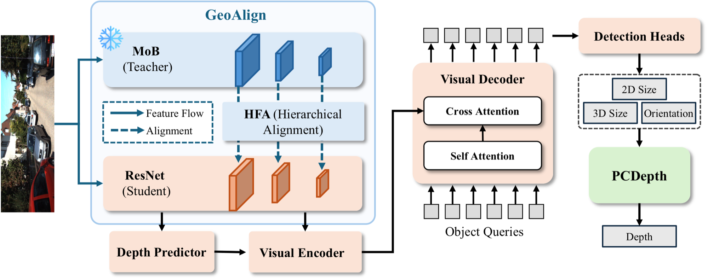

<div align="center">

# Rethinking Geometric Depth in Monocular 3D Object Detection: A Projection-Consistent Reformulation

[Zhihao Zhang](https://alanzhangcs.github.io/)<sup>1</sup>, [Abhinav Kumar](https://sites.google.com/view/abhinavkumar)<sup>1</sup>, [Huaizhi Qu](https://qhz991029.github.io/)<sup>2</sup>, [Tianlong Chen](https://tianlong-chen.github.io/)<sup>2</sup>, [Xiaoming Liu](https://cs.unc.edu/person/xiaoming-liu/)<sup>1,2</sup>

<sup>1</sup>Michigan State University &nbsp; <sup>2</sup>University of North Carolina at Chapel Hill

**NeurIPS 2026**

[](https://alanzhangcs.github.io/MonoPCA-Page/)


</div>

<p align="center">
  
</p>

**MonoPCA** shows that the widely used geometric depth $z = f \cdot H / h_{2D}$ recovers the depth of an object's visible front surface rather than its center. **PCDepth** corrects this bias in closed form with an orientation- and size-aware term, and **GeoAlign** distills a Vision Foundation Model teacher into a lightweight student to sharpen the size and yaw predictions PCDepth relies on, at no inference cost.

## Highlights

- **PCDepth (Projection-Consistent Depth).** PCDepth keeps the observable 2D box height $h_{2D}$. It adds back the box footprint's half-extent along the optical axis in closed form:

  $$z = \frac{f \cdot H}{h_{2D}} + \underbrace{\frac{1}{2}\left(L\,|\sin\gamma| + W\,|\cos\gamma|\right)}_{\Delta}$$

  $\Delta$ reduces to $W/2$ at $\gamma = 0^\circ$ and to $L/2$ at $\gamma = 90^\circ$. See [`lib/models/monopca/pcdepth.py`](lib/models/monopca/pcdepth.py).
- **MoB (Mixture of Backbone).** At every scale, MoB adaptively fuses a ResNet pyramid with a single-scale vision-foundation-model branch (EVA-02). See [`lib/models/monopca/mob.py`](lib/models/monopca/mob.py).
- **GeoAlign.** GeoAlign distills the MoB model into a ResNet-50 student with Hierarchical Feature Alignment (a cosine loss over all four pyramid scales). The teacher is discarded after training, so GeoAlign adds no inference cost. *(Code coming soon.)*
- **Multi-focal, multi-dataset training.** Each image is resampled to one of several virtual focal lengths. The model is conditioned on that focal length, so it can be trained jointly on KITTI, nuScenes and Waymo (11 classes).

## Installation

```bash
conda create -n monopca python=3.9 -y
conda activate monopca

# install PyTorch matching your CUDA version, e.g.
pip install torch torchvision --index-url https://download.pytorch.org/whl/cu121

pip install -r requirements.txt

# compile the deformable attention op
cd lib/models/monopca/ops
bash make.sh
cd ../../../..
```

`flash-attn` is optional. EVA-02 uses it automatically when it is installed.

## Data Preparation

We use the KITTI, nuScenes (front camera) and Waymo (front camera) data in KITTI format prepared by [DEVIANT](https://github.com/abhi1kumar/DEVIANT).

1. **Download and convert the datasets** by following DEVIANT's [data setup instructions](https://github.com/abhi1kumar/DEVIANT/blob/main/data/data_setup_README.md). The result is:

   ```
   DEVIANT/data
   ├── KITTI        # training/{calib,image_2,label_2}, testing/{calib,image_2}
   ├── nusc_kitti   # training/{calib,image,label}, validation/{calib,image,label}
   └── waymo        # training/{calib,image,label}, validation/{calib,image,label}
   ```

2. **Link them into MonoPCA:**

   ```bash
   mkdir -p data
   ln -sfn /path/to/DEVIANT/data/KITTI      data/KITTIDataset
   ln -sfn /path/to/DEVIANT/data/nusc_kitti data/NUSCDataset
   ln -sfn /path/to/DEVIANT/data/waymo      data/WaymoDataset
   ```

3. **Capitalize the nuScenes class names** (e.g. `car` → `Car`). This writes `label_2/` next to `label/`:

   ```bash
   python tools/capitalize_nusc_labels.py --root data/NUSCDataset
   ```

The final layout is:

```
MonoPCA
├── data
│   ├── KITTIDataset
│   │   ├── training     # calib/, image_2/, label_2/
│   │   └── testing      # calib/, image_2/
│   ├── NUSCDataset
│   │   ├── training     # calib/, image/, label/, label_2/
│   │   └── validation   # calib/, image/, label/, label_2/
│   └── WaymoDataset
│       ├── training     # calib/, image/, label/
│       └── validation   # calib/, image/, label/
└── splits
    ├── train_kitti_nusc_waymo.txt
    └── val_kitti.txt
```

The merged split files in `splits/` are provided. Each line is `<DATASET> <sample_id>`, e.g. `KITTI 000003`. To build your own split from per-dataset split files (e.g. DEVIANT's `ImageSets/train.txt`), run:

```bash
python tools/create_split.py \
    --inputs KITTI:data/KITTIDataset/ImageSets/train.txt \
             NUSC:data/NUSCDataset/ImageSets/train.txt \
             Waymo:data/WaymoDataset/ImageSets/train.txt \
    --output splits/train_kitti_nusc_waymo.txt
```

## Pretrained Weights

- **EVA-02-L:** download `eva02_L_coco_seg_sys_o365.pth` from [EVA-02 detection](https://github.com/baaivision/EVA/tree/master/EVA-02/det) and put it at `pretrained/eva02_L_coco_seg_sys_o365.pth`.
- **ResNet-50:** downloaded automatically on first run.
- **Focal-length embeddings:** included at `assets/focal_list_feat.npy`.

## Training

```bash
# bash scripts/train.sh [GPUS] [PORT] [CONFIG] [SEED]
bash scripts/train.sh 0,1,2,3 29500 configs/monopca_kitti_nusc_waymo.yaml 444
```

Checkpoints and logs are written to `outputs/monopca_kitti_nusc_waymo/`.

## Evaluation

Set `tester.checkpoint_path` in the config to the checkpoint you want to evaluate, then run:

```bash
bash scripts/test.sh 0 29501 configs/monopca_kitti_nusc_waymo.yaml
```

## Project Structure

```
configs/                 training configs
tools/train_val.py       training / evaluation entry point
lib/models/monopca/
├── monopca.py           MonoPCA model and losses
├── mob.py               MoB: Mixture of Backbone (ResNet + EVA-02)
├── pcdepth.py           PCDepth: geometry-based depth prior
├── backbones/           EVA-02 and ResNet backbones
├── depth_predictor/     depth predictor (depth embedding) and DDN loss
├── depthaware_transformer.py  deformable transformer; the depth embedding is an extra encoder level
└── ops/                 multi-scale deformable attention CUDA op
lib/datasets/kitti/      KITTI + nuScenes + Waymo multi-focal dataset and KITTI evaluation
lib/helpers/             trainer, tester, optimizer, scheduler, decoding
```

## Acknowledgements

This project builds on [MonoDETR](https://github.com/ZrrSkywalker/MonoDETR), [MonoDGP](https://github.com/PuFanqi23/MonoDGP), [MonoCoP](https://github.com/alanzhangcs/MonoCoP), [MonoIA](https://github.com/alanzhangcs/MonoIA), [DEVIANT](https://github.com/abhi1kumar/DEVIANT), [DETR](https://github.com/facebookresearch/detr), [Deformable DETR](https://github.com/fundamentalvision/Deformable-DETR), [EVA-02](https://github.com/baaivision/EVA), [detectron2](https://github.com/facebookresearch/detectron2), [RT-DETR](https://github.com/lyuwenyu/RT-DETR) and [CaDDN](https://github.com/TRAILab/CaDDN). We thank the authors for releasing their code.

## License

This project is released under the [MIT License](LICENSE). Some files are derived from third-party projects and keep their original licenses in their headers (e.g. the deformable attention op from Deformable DETR, under Apache-2.0).

## Citation

```bibtex
@inproceedings{zhang2026rethinking,
  title     = {Rethinking Geometric Depth in Monocular 3D Object Detection:
               A Projection-Consistent Reformulation},
  author    = {Zhang, Zhihao and Kumar, Abhinav and Qu, Huaizhi and
               Chen, Tianlong and Liu, Xiaoming},
  booktitle = {Advances in Neural Information Processing Systems (NeurIPS)},
  year      = {2026}
}
```
